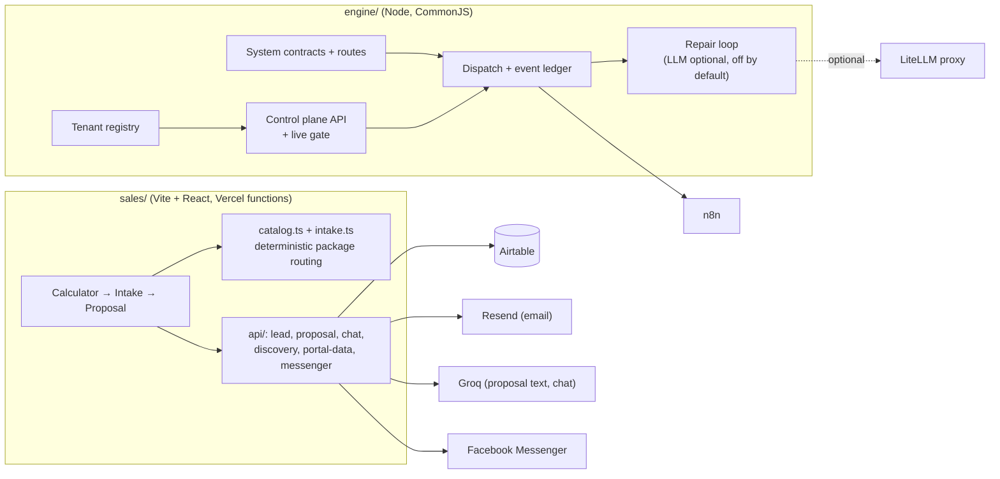

# Flowstack OS

## Status

**Archived.** It is no longer developed.

All business data in the repo is fictional: the sample tenant is "Sample Tours" (`sampletours_samplecity`), contacts use `.example` domains, phone numbers look like `0900 000 0001`, and the package prices are sample prices.

## What it was

Deterministic revenue operations for Philippine small and medium businesses: find out how much revenue a business loses to slow or missed replies, recommend a service package, capture the lead, and run the follow-up workflows behind it.

The repo has two parts:

| Folder | What it is |
| --- | --- |
| `sales/` | The sales front end and its serverless API. A visitor enters their numbers in a leakage calculator, answers a short intake form, and gets a package recommendation and a proposal. A client portal and a discovery intake sit alongside. |
| `engine/` | The control plane. Workflow contracts and the routes between them, tenant registry, dispatch to n8n, an event ledger, a repair loop, and a "live gate" that keeps live changes behind explicit approval. |

## Design rule

**Deterministic orchestration, LLM advice only.**

- The package recommendation is plain code: leakage thresholds in `sales/services/catalog.ts`, form-answer rules and enterprise triggers in `sales/services/intake.ts`. The same input always gives the same output. There is no model call in either file.
- In the proposal view the recommendation is computed before any model runs. The model (Groq) only writes the proposal wording around it. It does not choose the package or the price.
- In the engine, workflows run from contracts and routes, not from model output. The one LLM path is the repair loop, and it is off by default (`ENABLE_LLM_REPAIR=0`). Demo mode (`FLOWSTACK_DEMO_MODE=1`) is also the default and mutates nothing live.

## Architecture



The two parts do not import each other. Each has its own config module (`sales/config.ts`, `engine/config.js`), and those are the only files that read `process.env`.

## Stack

- **sales/**: React 19, Vite 6, TypeScript 5.8, zod 4, jsPDF, react-markdown, Vercel serverless handlers (`@vercel/node`). Airtable REST, Resend and Groq over plain `fetch`.
- **engine/**: Node.js, CommonJS, no framework and no runtime dependencies. Targets n8n for workflows and an optional LiteLLM proxy for repair.
- **Tests**: `node --test` for both parts. The sales tests are TypeScript, bundled with esbuild by `sales/tests/run.mjs`.

## Why it stopped

Flowstack began as lead-to-booking automation for Philippine SMBs. Its scope drifted into a general revenue-ops and governance system, so I stopped it.

## Known gaps

This is a snapshot, not a finished product. Known issues, left as they were when it was archived:

- `sales/api/lead.ts` still returns the error message in a `details` field on failure. The stack trace is no longer returned.
- When a proposal request fails, `sales/api/proposal.ts` returns the upstream error text, which can include "Missing GROQ_API_KEY on server".
- `sales/api/messenger.ts`: the webhook verification step passes when `FB_VERIFY_TOKEN` is unset, because both sides of the comparison are `undefined`. Set the variable if you ever run it.
- `sales/api/lead.ts` stores the `recommendedPackage` sent by the client instead of recomputing it on the server.
- `engine/` declares no dependencies. Some modules expect packages such as `node-fetch` that are not installed.
- `engine/run_flowstack_control_plane_api.js` spawns `run_control_plane_api_server.js`, which is not in the repo, so the control plane API cannot start. Several engine scripts also assume they are run from inside `engine/`.
- Some engine modules (`compile_system_v3`, `dispatch_runtime_v2`, `event_ledger`, `route_system_events`, `system_contracts`, `validate_dispatch_payloads`, `validate_system`) are not wired to any runnable entry point. They are exercised only by the unit tests.
- `sales/flowstack.test.js` and `sales/security.test.js` are integration suites. They need a running server and, for some cases, real service credentials. They are not part of `npm test`.
- The client portal's demo mode returns fixed example figures, not computed ones.

## How to run

Requires Node.js. It was developed and tested on Node 24.

### Tests and contract checks (no services, no keys)

```sh
npm --prefix sales install
npm test               # engine tests, then sales tests
npm run test:engine
npm run test:sales
npm run contracts      # the 4 negative-matrix suites in engine/artifacts
```

### Sales app with the demo tenant

```sh
npm --prefix sales install
cp .env.example sales/.env   # Vite and the Vercel CLI read sales/.env. It is git-ignored and the values are placeholders
npm --prefix sales run dev    # http://localhost:3000
```

This serves the calculator, intake form and proposal screens. The `/api/*` routes are Vercel functions and are not served by `vite`. To run them locally, use the Vercel CLI from `sales/` (`npx vercel dev`) (it reads `sales/.env`). I did not run `vercel dev` when preparing this repo. I checked the handlers directly with mock requests.

The demo tenant is Sample Tours (`sampletours_samplecity`). `.env.example` maps the demo token to it:

```
PORTAL_TOKENS={"demo-client":"sampletours_samplecity"}
DISCOVERY_TOKENS={"demo-client":"sampletours_samplecity"}
```

With those set, the client portal accepts the token `demo-client` (at `/dashboard/portal.html`, or as `Authorization: Bearer demo-client` / `X-Portal-Token` on `/api/portal-data`). With no Airtable credentials configured, the portal returns fixed demo figures.

**Deny by default.** If `PORTAL_TOKENS` and `DISCOVERY_TOKENS` are unset, or are not valid JSON, the registry is empty and every request is refused with 401. `demo-client` is a local demo token only. Use long random values for anything else.

Without keys the lead, proposal, chat and discovery handlers cannot reach Airtable, Resend or Groq. Fill in the matching variables in `sales/.env` to try them against your own accounts.

### Engine

The engine reads real environment variables only. It does not load `.env` files. Its paths all live under `FLOWSTACK_HOME` (default `./data`, git-ignored). The control plane API cannot start (see Known gaps), so the runnable parts are the unit tests and `npm run contracts`.

## License

MIT. See [LICENSE](LICENSE).
